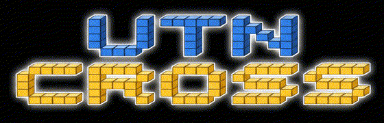

  

----

  

---

UTN Cross es un juego inspirado en el estilo de Crossy Road. Está realizado con Wollok Game aplicando conceptos de Programación Orientada a Objetos (POO).

---

  

---

Hay 5 niveles; en cada uno de ellos el objetivo es llegar al otro lado de la pantalla, cruzando las calles y evitando a los enemigos (autos, colectivos, etc.). Cada vez que el jugador colisione con un enemigo, perderá una vida. Para ganar el juego, es necesario superar los niveles consecutivamente. El último nivel es el más difícil y representa el desafío final: llegar a la UTN.

---

  

---

El juego consta de 3 tipos de enemigos distintos, donde todos te sacan una vida.
- Autos
- Bondis
- Trenes
  
---

  

---

A lo largo del juego vamos a encontrar elementos que nos pueden servir para seguir avanzando. Estos elementos los debemos recolectar a medida que recorremos los niveles.
- Mate (otorga 1 vida extra)
- Monster (velocidad)
- Escudo (te hace inmune a los enemigos)

 ---

  

---

Los puntos se consiguen recolectando los powerups y los distintos objetos que están dispersos por el mapa. Mientras más agarres, más puntos conseguís.